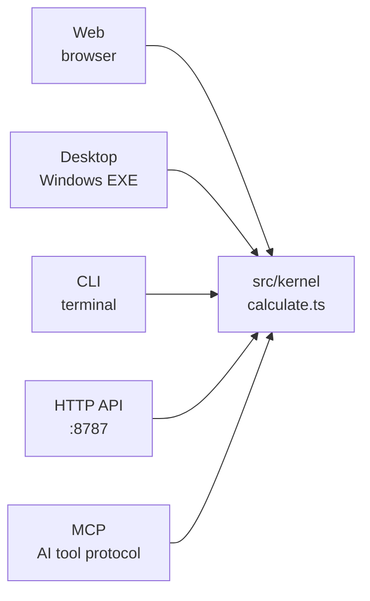
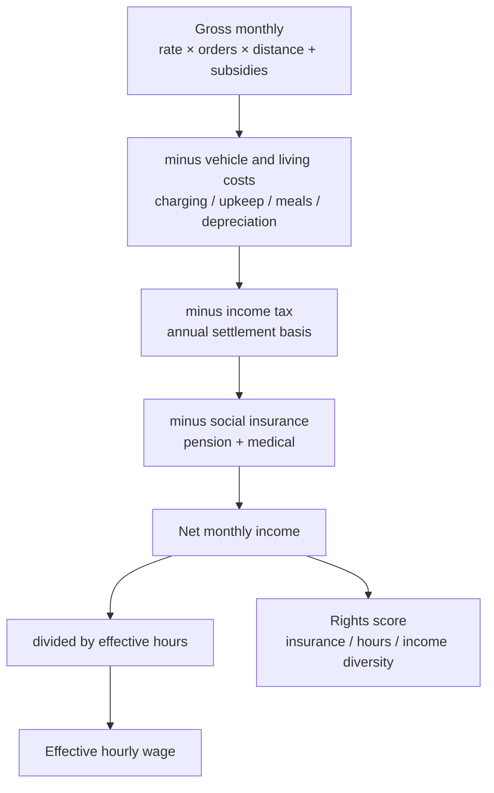
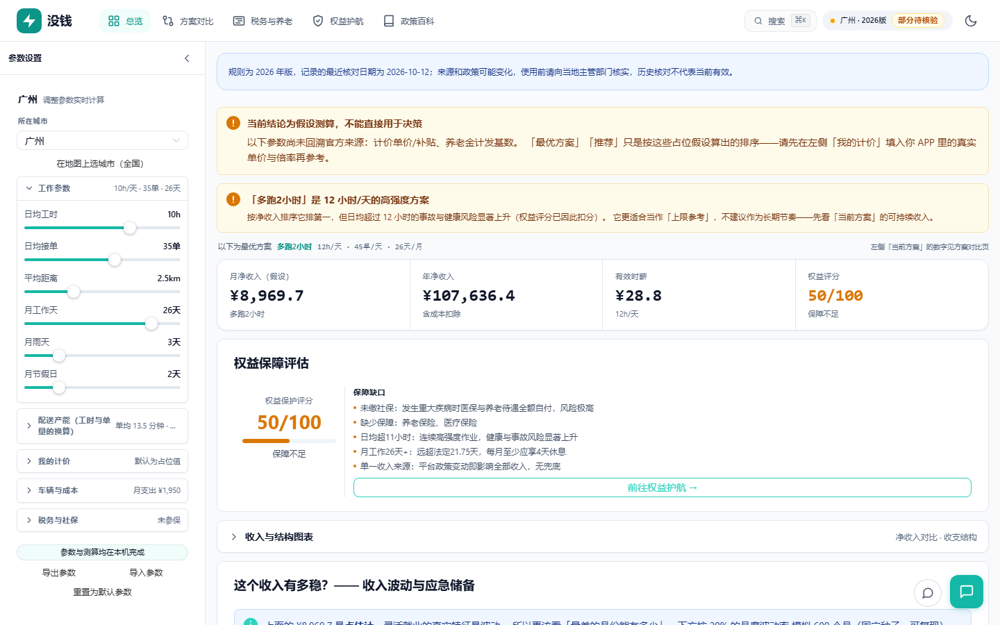
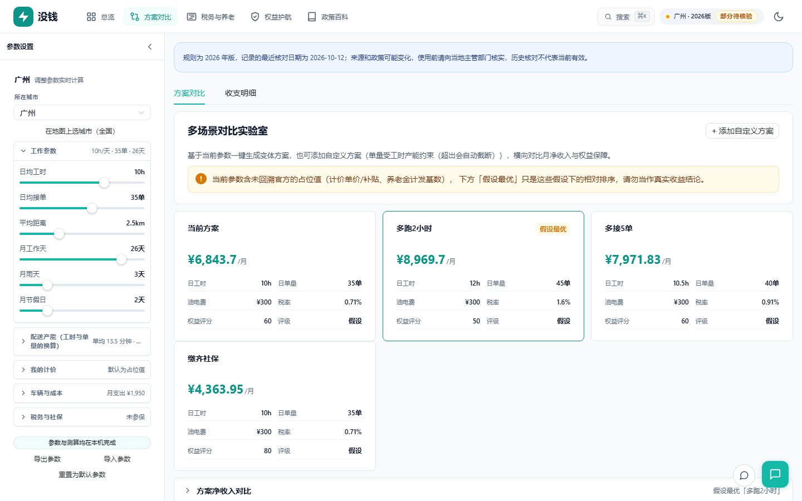
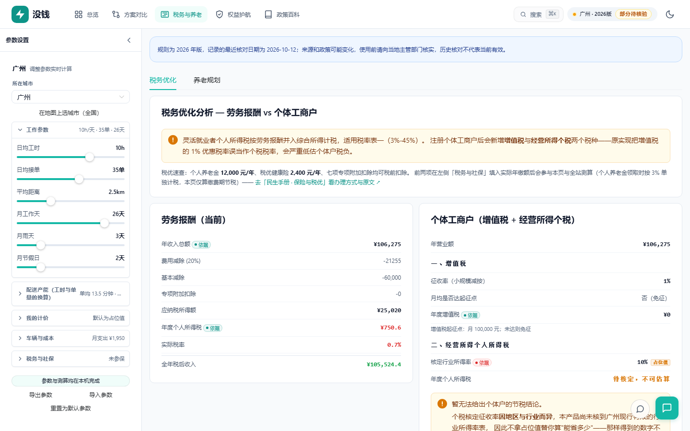
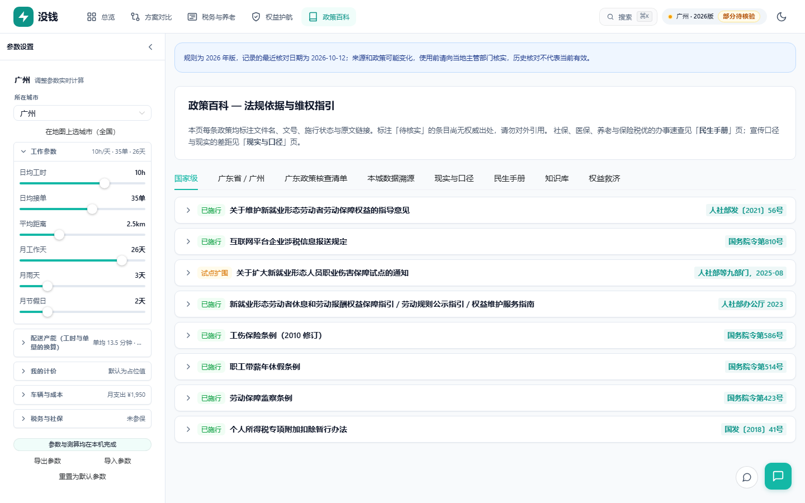
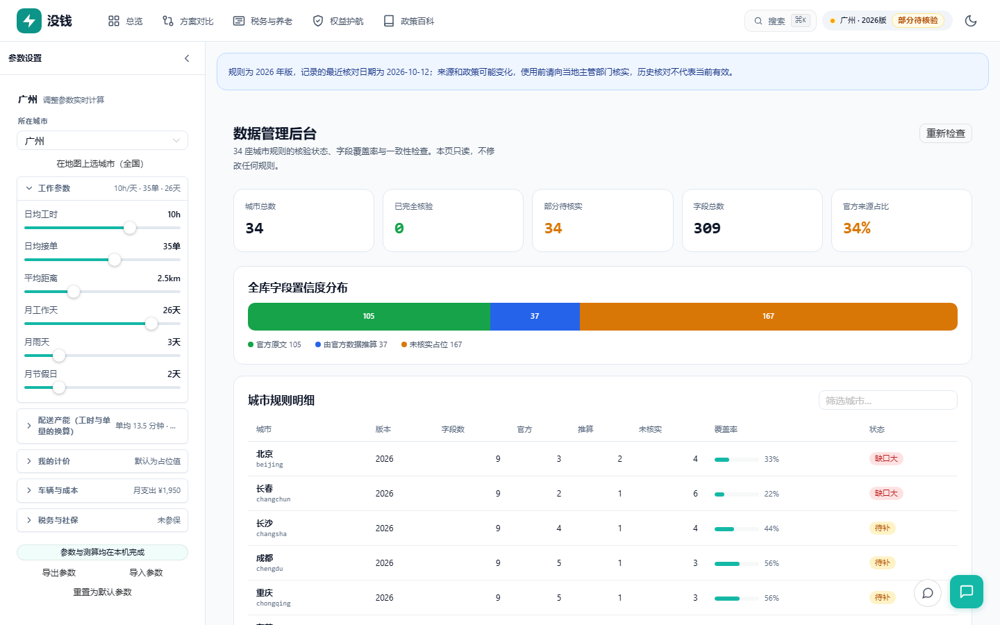

<div align="center">

# No Money

**A gig job says "up to ¥10,000 a month." This tells you how that number is built — and which parts of it are unverified.**

Income, tax, social insurance and labor-rights calculator for China's gig workers.

[](https://github.com/badhope/no-money/actions/workflows/ci.yml)
[](https://github.com/badhope/no-money)
[](https://github.com/badhope/no-money)
[](#data-coverage)
[](#privacy)
[](LICENSE)

[简体中文](README.md) · **English**

</div>

---

## Four ways to run it

One calculation kernel, four entry points.



| Entry | Command | Use when |
|---|---|---|
| **Web** | `npm run dev` | Everyday use, full interface |
| **Desktop** | Install `NoMoney_2.4.0_x64-setup.exe` | Offline, no browser |
| **CLI** | `npm run cli -- calc --city shenzhen` | Batch comparison, scripting |
| **API** | `npm run api` | System integration |
| **MCP** | `npm run mcp` | Let an AI assistant compute directly |
| **PWA** | "Install" in the address bar | Install to desktop, works offline |

### Quick start

```bash
npm ci
npm run dev        # http://localhost:3000
```

```bash
# What does delivery work actually pay in Guangzhou?
npm run cli -- calc --city guangzhou

# Compare three cities
npm run cli -- compare --cities guangzhou,shenzhen,dongguan

# Verify all 34 city rule files
npm run cli -- check
```

---

## How the number is built



**Every step expands to line items in the UI.** No black box.

---

## Data coverage

```
34 cities · all 31 provincial-level regions

official   ███████████████░░░░░░░░░░░░░░░░░░░░░░░   105 items (34%)
derived    ██████░░░░░░░░░░░░░░░░░░░░░░░░░░░░░░░░    37 items (12%)
unverified ████████████████████████░░░░░░░░░░░░░░   167 items (54%)
```

Every parameter carries a confidence level:

| Level | Meaning | Shown as |
|---|---|---|
| `official` | Traced to a government document number and source link | verified |
| `derived` | Computed from official figures, not directly published | derived |
| `unverified` | No authoritative source; placeholder only | unverified |

**When a result depends on an unverified field, the UI downgrades "best option" to "assumed best" and names exactly which fields are missing.**

Platform per-order pricing is always `unverified` — it is a commercial term with no public authority. The only honest path is the user entering their own real rate.

---

## Why this exists

A delivery rider is told "up to ¥10,000 a month." That number hides four things:

- The per-order rate is a placeholder, not their real rate
- Social insurance is unpaid, so a hospital stay is 100% out of pocket
- Working 12h/day is the only way the number works — and that carries real injury risk
- Tax depends on whether they register as a sole proprietor, and most calculators get the rate wrong

**This tool makes all four assumptions visible, and refuses to print a confident number when the input isn't verified.**

---

## Screenshots

<table>
<tr>
<td width="50%"></td>
<td width="50%"></td>
</tr>
<tr>
<td><b>Overview</b> — net income, effective hourly wage, rights score, with the weakest link named</td>
<td><b>Scenario lab</b> — compare work patterns, ranked by sustainable income</td>
</tr>
<tr>
<td></td>
<td></td>
</tr>
<tr>
<td><b>Tax and pension</b> — labor remuneration and sole proprietorship computed separately</td>
<td><b>Rights</b> — compensation amounts with legal basis for five dispute types</td>
</tr>
<tr>
<td></td>
<td></td>
</tr>
<tr>
<td><b>Policy wiki</b> — every parameter traced to its source</td>
<td><b>Data admin</b> — coverage statistics and consistency checks</td>
</tr>
</table>

---

## The five modules

| Module | Answers |
|---|---|
| **Overview** | Net monthly income, effective hourly wage, rights score — and the weakest link |
| **Scenario lab** | What a different work pattern pays, and whether it is worth it |
| **Tax and pension** | Labor remuneration vs sole proprietorship; how many years of contributions break even |
| **Rights** | What you can claim for unpaid wages, injury or wrongful dismissal, and under which article |
| **Policy wiki** | This city's insurance bases, minimum wage and tax rates — with sources |

---

## Privacy

```
No backend        No account        No telemetry
No third-party JS Data stays local  Fully offline
```

**Works offline**: once installed as a PWA, the app opens and computes with no network. Verified by a real offline E2E test.

The AI assistant is **opt-in**:
- API key lives in memory unless you tick "remember"
- Chat history stays in the tab unless you tick "remember history"
- Only the calculation context and your question are sent, to the endpoint **you** configure
- Non-local endpoints must be HTTPS; credentials embedded in URLs are rejected

See [SECURITY.md](SECURITY.md).

---

## Development

```bash
npm ci
npm run dev            # web dev server
npm test               # 1041 unit tests
npm run test:e2e       # 84 browser tests (builds first)
npm run typecheck      # type check
npm run verify         # engine identity self-check
npm run verify:reality # data reality check
npm run kb:check       # knowledge base sync
npm run build          # production build
npm run tauri:build    # Windows installer
```

**Architecture**: `views → components → stores → application → domain`, one-way.
Every entry point calls `src/kernel/calculate.ts`. No entry point re-implements a formula.

Full conventions in [AGENTS.md](AGENTS.md) and [ARCHITECTURE.md](ARCHITECTURE.md).

---

## Known limits

| Limit | Detail |
|---|---|
| Tax basis | **Annual settlement**, not platform withholding. If a platform withholds, the real amount uses a different rate table |
| Volatility | Multiplicative model; bans and injury are not modeled |
| Provincial values | 19 provincial capitals use national-magnitude placeholders, labeled `unverified` |
| Scope | A decision aid, not tax or legal advice |

---

## Documentation

| Document | Contents |
|---|---|
| [AGENTS.md](AGENTS.md) | Conventions for AI coding agents |
| [ARCHITECTURE.md](ARCHITECTURE.md) | Layers and data flow |
| [ROADMAP.md](ROADMAP.md) | Roadmap and priorities |
| [SECURITY.md](SECURITY.md) | Security model and reporting |
| [CONTRIBUTING.md](CONTRIBUTING.md) | Contribution guide |
| [docs/VERSIONING.md](docs/VERSIONING.md) | Version policy |
| [docs/DEPLOYMENT.md](docs/DEPLOYMENT.md) | Deployment and cache headers |
| [PRIVACY.md](PRIVACY.md) | Privacy policy |
| [TERMS.md](TERMS.md) | Terms of service |
| [THIRD-PARTY-NOTICES.md](THIRD-PARTY-NOTICES.md) | Third-party licenses |

## License

[MIT](LICENSE)
