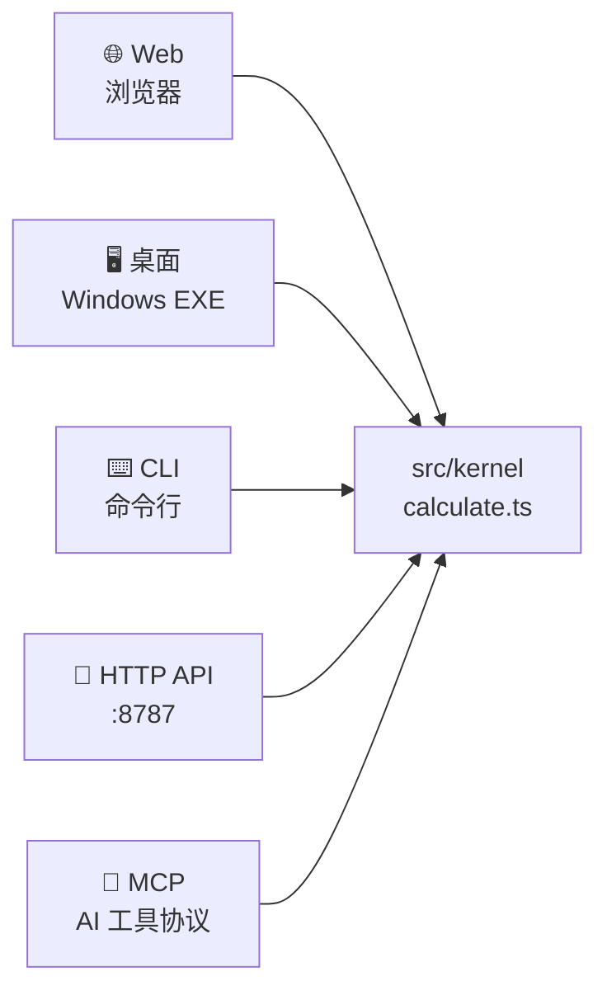
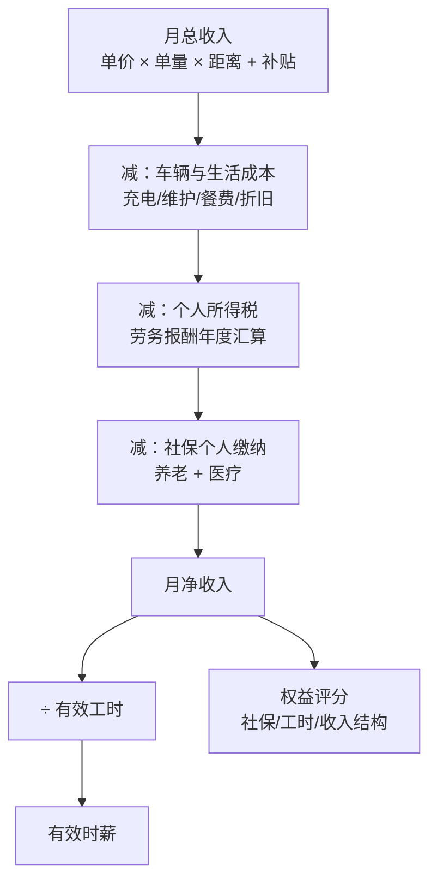
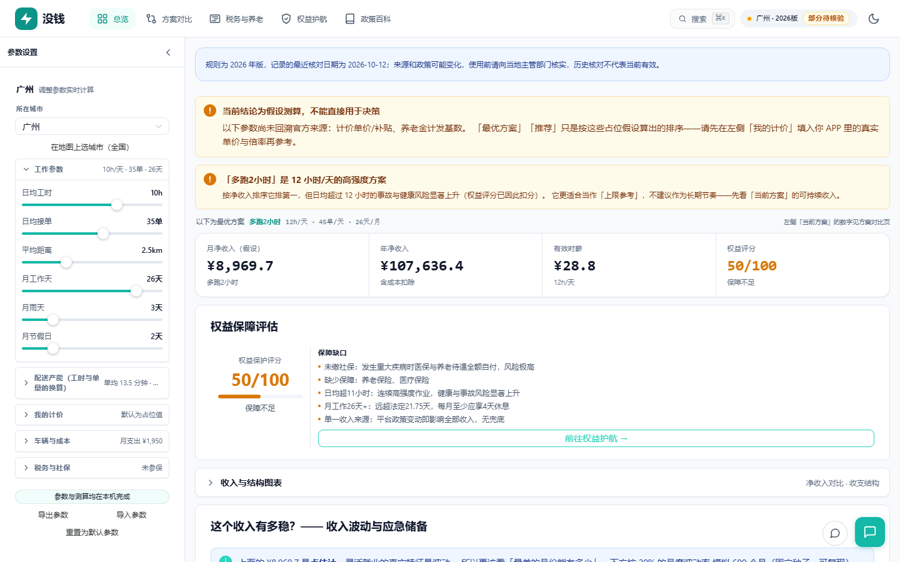
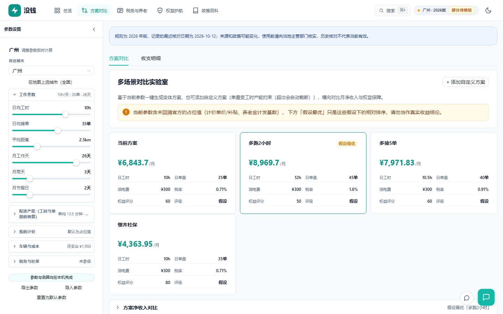
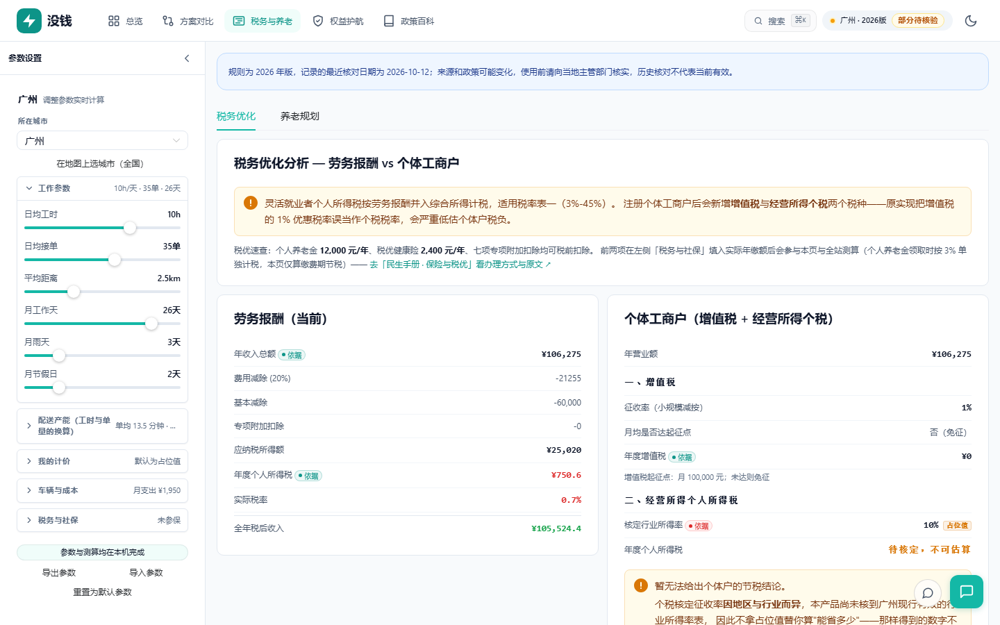
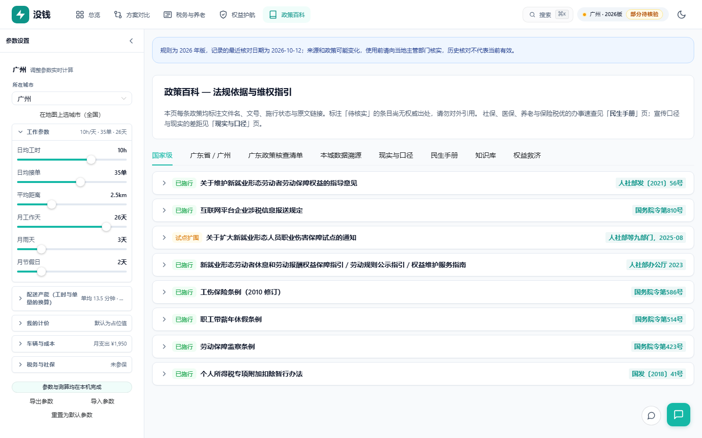
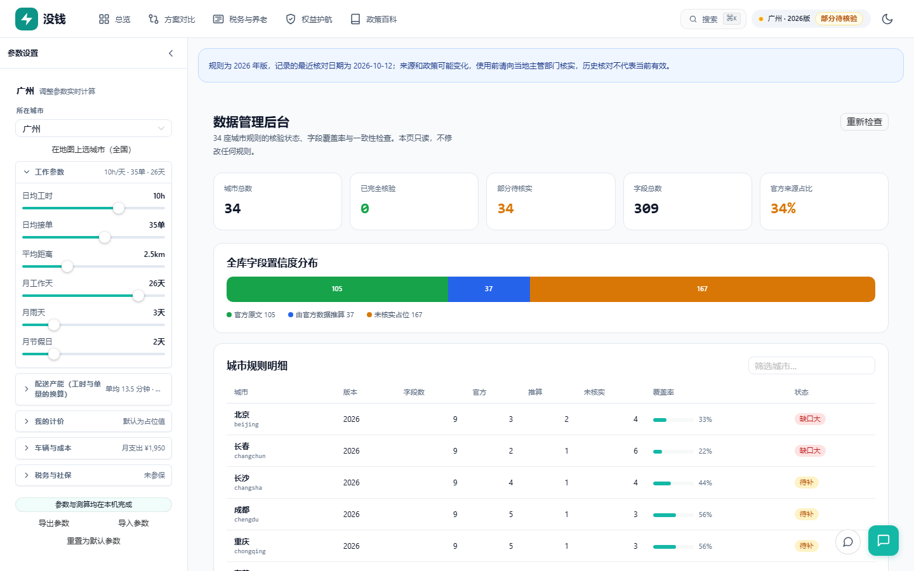

<div align="center">

# 没钱 No Money

**别人说「月入过万」，这个工具告诉你这笔钱是怎么算出来的、哪一部分还没核实。**

面向中国灵活就业者（外卖骑手、网约车司机等）的收入 / 个税 / 社保 / 权益测算平台。

[](https://github.com/badhope/no-money/actions/workflows/ci.yml)
[](https://github.com/badhope/no-money)
[](https://github.com/badhope/no-money)
[](#数据覆盖)
[](#隐私)
[](LICENSE)

**简体中文** · [English](README.en.md)

</div>

---

## 算力入口

同一套计算内核，四种用法。



| 入口 | 命令 | 适合 |
|---|---|---|
| **Web** | `npm run dev` | 日常使用，全功能界面 |
| **桌面** | 安装 `没钱 No Money_2.4.0_x64-setup.exe` | 离线使用，无需浏览器 |
| **CLI** | `npm run cli -- calc --city shenzhen` | 批量对比、脚本化 |
| **API** | `npm run api` | 内部系统集成 |
| **MCP** | `npm run mcp` | 让 AI 助手直接算 |
| **PWA** | 浏览器地址栏「安装」 | 装到桌面，断网可用 |

### 30 秒上手

```bash
npm ci
npm run dev        # 打开 http://localhost:3000
```

```bash
# 命令行：广州跑外卖，一个月到手多少
npm run cli -- calc --city guangzhou

# 三个城市横向对比
npm run cli -- compare --cities guangzhou,shenzhen,dongguan

# 34 城规则完整性自检
npm run cli -- check
```

---

## 这个数字是怎么来的



**每一步都可在界面上展开看明细。** 没有黑箱。

---

## 数据覆盖

```
34 座城市 · 全部 31 个省级行政区

官方原文   ███████████████░░░░░░░░░░░░░░░░░░░░░░░   105 项 (34%)
推算得出   ██████░░░░░░░░░░░░░░░░░░░░░░░░░░░░░░░░    37 项 (12%)
未核实占位 ████████████████████████░░░░░░░░░░░░░░   167 项 (54%)
```

每个参数都带来源等级：

| 等级 | 含义 | 界面上 |
|---|---|---|
| `official` | 能追到政府文号与原文链接 | ✅ 已核实 |
| `derived` | 由官方数据推算，非直接公布 | 🔶 推算 |
| `unverified` | 无权威来源，仅占位 | ⚠️ 待核实 |

**当结论依赖未核实字段时，界面会把「最优方案」降级为「假设最优」，并列出具体哪几个字段没核实。**

平台计价单价永远是 `unverified`——它是平台商业规则，没有官方发布渠道。唯一正确的做法是你自己填入 APP 里的真实单价。

---

## 为什么要做这个

一个骑手被告知「月入过万」。这个数字藏了四件事：

- 计价单价是占位值，不是他的真实单价
- 社保没缴，住一次院全部自付
- 只有每天干 12 小时这个数才成立，而这带来真实的工伤风险
- 税取决于是否注册个体户，多数计算器把税率算错

**这个工具把这四项假设全部摊开；输入没有核实来源时，不给出确定结论。**

---

## 界面

<table>
<tr>
<td width="50%"></td>
<td width="50%"></td>
</tr>
<tr>
<td><b>总览</b> — 净收入、有效时薪、权益评分，点名最薄弱的一环</td>
<td><b>方案对比</b> — 横向比较多套工作节奏，按可持续收入排序</td>
</tr>
<tr>
<td></td>
<td></td>
</tr>
<tr>
<td><b>税务与养老</b> — 劳务报酬与个体工商户两套税制分开算</td>
<td><b>权益护航</b> — 五类纠纷的补偿金额与法律依据</td>
</tr>
<tr>
<td></td>
<td></td>
</tr>
<tr>
<td><b>政策百科</b> — 34 城参数逐条溯源</td>
<td><b>数据后台</b> — 覆盖率统计与一致性检查</td>
</tr>
</table>

---

## 五个模块

| 模块 | 回答什么 |
|---|---|
| **总览** | 月净收入、有效时薪、权益评分，最薄弱的一环是什么 |
| **方案对比** | 换一套工作节奏能多赚多少，值不值 |
| **税务与养老** | 劳务报酬 vs 个体户，哪套更省；社保缴多少年划算 |
| **权益护航** | 被欠薪/工伤/违法解约能拿多少，依据哪条法 |
| **政策百科** | 这座城市的社保基数、最低工资、税率是多少，出处在哪 |

---

## 隐私

```
✅ 无后端        ✅ 无账号        ✅ 无埋点
✅ 无第三方脚本  ✅ 数据不出设备  ✅ 可完全离线
```

**可离线**：安装为 PWA 后，断网也能打开并完成测算。实测断网后页面完整可用。

AI 助手是**可选**的：
- API Key 默认只在内存，勾选「记住」才落盘
- 对话历史默认只存当前标签页
- 只发送测算上下文与你填的问题，发往**你自己配置**的端点
- 非本机端点强制 HTTPS，拒绝 URL 内嵌凭据

详见 [SECURITY.md](SECURITY.md)。

---

## 开发

```bash
npm ci
npm run dev            # Web 开发服务器
npm test               # 1061 项单元测试
npm run test:e2e       # 84 项浏览器测试（构建 + 跑）
npm run typecheck      # 类型检查
npm run verify         # 引擎恒等式自检
npm run verify:reality # 数据现实性核查
npm run kb:check       # 知识库同步检查
npm run build          # 生产构建
npm run tauri:build    # Windows 安装包
```

**架构**：`views → components → stores → application → domain`，单向依赖。
所有入口共用 `src/kernel/calculate.ts`，绝不各自重算。

完整开发约定见 [AGENTS.md](AGENTS.md) 与 [ARCHITECTURE.md](ARCHITECTURE.md)。

---

## 已知边界

| 边界 | 说明 |
|---|---|
| 税制口径 | 按**年度汇算**算，不是平台预扣预缴。若平台代扣，实际到手用另一套税率表 |
| 波动模型 | 乘性模型，未建模封号与工伤等尾部事件 |
| 省级代表值 | 19 个省会用全国量级占位，已标 `unverified` |
| 定位 | 决策辅助工具，不构成税务或法律意见 |

---

## 文档

| 文档 | 内容 |
|---|---|
| [AGENTS.md](AGENTS.md) | AI 编码代理的开发约定 |
| [ARCHITECTURE.md](ARCHITECTURE.md) | 分层与数据流 |
| [ROADMAP.md](ROADMAP.md) | 路线图与优先级 |
| [SECURITY.md](SECURITY.md) | 安全模型与漏洞上报 |
| [CONTRIBUTING.md](CONTRIBUTING.md) | 贡献指南 |
| [docs/VERSIONING.md](docs/VERSIONING.md) | 版本规范 |
| [docs/DEPLOYMENT.md](docs/DEPLOYMENT.md) | 部署与缓存头配置 |
| [PRIVACY.md](PRIVACY.md) | 隐私政策 |
| [TERMS.md](TERMS.md) | 服务条款 |
| [THIRD-PARTY-NOTICES.md](THIRD-PARTY-NOTICES.md) | 第三方许可 |

## 许可

[MIT](LICENSE)
